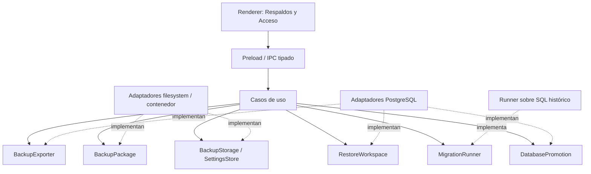

# Auditoría previa de Respaldos y Restauración — diseño para v1.3.0

Fecha: 2026-10-14 (America/Guayaquil). Base revisada: aplicación 1.2.1, esquema 10. Estado: auditoría estática completada; implementación y certificación de recuperación pendientes.

## 1. Alcance y controles iniciales

Solo lectura de fuentes y escritura de los dos entregables Markdown expresamente solicitados. La instrucción de no modificar archivos se aplica al código, datos y evidencia; la excepción documental es el apartado entregables del pedido. No se ejecutaron la aplicación, consultas SQL, backups, restores, seed, tests, build, Docker ni publicación Git.

El directorio recibido contiene `electron-app` y una copia histórica `electron-app-backup`. La raíz Git real es `electron-app`; la copia no es la fuente del módulo actual. Los primeros comandos Git en el directorio contenedor fallaron por no ser repositorio. Repetidos en `electron-app`: `git status --short` vacío, `git diff` vacío y rama `feature/escalabilidad-postgresql`. `git branch --list` solo mostró esa rama y `main`. Se creó `feature/respaldos-restauracion` desde el HEAD actual, sin cambiar código ni descartar trabajo, conforme a la rama objetivo solicitada. No se encontraron archivos AGENTS.md en el árbol del workspace.

No se inspeccionaron credenciales cifradas ni datos comerciales reales. Los resultados de pruebas citados abajo describen las aserciones presentes en fuentes; no significan una nueva ejecución exitosa. La continuidad histórica conserva sus propias evidencias e incidencias.

## 2. Dictamen

Hay infraestructura importante que reutilizar: dump custom consistente, checksum/manifiesto, respaldo previo a migraciones, retención, motor privado, hashes portables, migraciones transaccionales y pruebas aisladas. Existe restore funcional como herramienta técnica, pero restaura directamente el esquema de la base activa. No satisface el principio de conservar intacta la única base activa.

La recuperación en una PC nueva es **viable por diseño, pendiente de certificación**. El dump lógico no requiere contraseñas técnicas originales ni AppData original; el programa debe conectarse con credenciales nuevas, ignorar propietarios/permisos de origen y restaurar en un destino vacío. Actualmente la herramienta exige un par `.dump` + `.dump.json`, nombre de base igual, esquema igual y PostgreSQL major igual. No existe selección de archivo ni restauración desde Crear usuario.

**Migración 011 necesaria: NO para el alcance diseñado.** Formato, destinos, retención y coordinación son infraestructura/configuración local. Las tablas comerciales y `migraciones` existentes bastan. Reevaluar solo si un requisito posterior demuestra necesidad de persistencia comercial adicional; no crear 011 para almacenar rutas locales.

Riesgo general: **alto para reutilizar el restore técnico como producto sin cambios; medio/alto para implementar la promoción y recuperación tras corte**, reducible con aislamiento y pruebas de fallos. No prometer recuperación certificada antes del ensayo A → B.

## 3. Inventario de fuentes y funciones

Rutas relativas a la raíz Git `electron-app`.

| Fuente | Hallazgo y reutilización |
|---|---|
| `src/main/database/respaldos.ts` | `Respaldos.crear`, `herramienta`, `argumentosConexion`, `retencion`, `validarRestauracion` y `verificarRespaldo`; núcleo actual del respaldo |
| `src/main/database/base.ts` | `iniciar`, `transaccion`, `respaldarManual`, `respaldarCierre`, `cerrar`, `desconectar`, login/usuarios/recuperación y coordinación de jornadas |
| `src/main/database/conexion.ts` | Composición de BaseLocal/Respaldos/PostgresLocal; prioridad de postgres.enc; marcador restauracion-pendiente; estadoAcceso |
| `src/main/database/postgres-local.ts` | Binarios, initdb, SCRAM, credenciales aleatorias, ACL Windows, arranque/cierre; administración privada sin contrato público para staging/promoción |
| `src/main/database/schema.ts`, `relacional.ts`, `migracion-{tres,cuatro,cinco,seis,siete,ocho,nueve,diez}.ts` | Cadena 1–10 y SQL de normalización 2; estructuras comerciales, identidad, usuarios y notificaciones |
| `database/001-*.sql` a `010-*.sql` | SQL histórico exportado; conservar inmutable |
| `src/main/database/seguridad.ts`, `recuperacion.ts`, `errores.ts` | scrypt, firmas Ed25519 de recuperación, errores/logs sanitizados |
| `src/main/database/ipc.ts`, `src/preload/index.ts`, `index.d.ts`, `src/shared/persistencia.ts` | API tipada y canales permitidos; cola y comprobación de emisor/frame; no hay API de backup/restore |
| `src/renderer/src/components/Acceso.tsx`, `src/renderer/src/App.tsx` | Crear usuario/Login/recuperar acceso; punto futuro de onboarding |
| `src/main/index.ts`, `documentos.ts` | Diálogo guardar PDF y separación Renderer/Main aprovechables como patrón, no como API genérica de archivos |
| `scripts/mantenimiento.cjs`, `entorno-db.cjs`, `package.json` | `db:backup` y `db:restore` técnicos; inicialización puede arrancar/crear motor, por eso no se ejecutaron |
| `scripts/preparar-postgres.cjs`, `verificar-distribucion.cjs`, `electron-builder.yml` | Distribución binaria offline, comprobación de herramientas y exclusión de datos/secretos/scripts del instalador |
| `tests/run.cjs`, `migracion*.cjs`, `v3.cjs`, `postgres-local.cjs`, `pgctl-arranque.cjs` | Arnés aislado y cobertura aprovechable; ver sección 12 |

### Inventario completo de referencias pg_dump/pg_restore en TS/CJS mantenido

Búsqueda en fuentes, scripts y tests, excluyendo dependencias, binarios y compilados:

- Ejecución central: `respaldos.ts`: versión de pg_dump, dump `-Fc --snapshot`, inspección `pg_restore --list`.
- Restore de soporte: `scripts/mantenimiento.cjs`.
- Dumps y restores de copias diagnósticas: `scripts/preparar-perfil-real.cjs` y `scripts/medir-comandos-snapshot.cjs`. Demuestran cómo conectar destino con configuración distinta; no son casos de uso del producto.
- Inspección de archivo: `scripts/aplicar-migracion-rendimiento.cjs`, `scripts/seed-datos-rendimiento.cjs` (no ejecutados).
- Pruebas: `tests/migracion-v2.cjs` restaura a otra base; `tests/v3.cjs` inspecciona dump y verifica integridad.
- Inventario de ejecutables: `scripts/preparar-postgres.cjs`, `scripts/verificar-distribucion.cjs`.
- Menciones documentales en código: `scripts/documentar-perfil-real.cjs` y comentarios de los scripts anteriores.

## 4. Respaldo actual

`Respaldos.crear(pool,tipo,fechaJornada)` mantiene conexión, advisory lock 7302026 y transacción REPEATABLE READ; obtiene esquema, major, revisión de auditoría y snapshot exportado. Exige major de pg_dump igual al servidor. Ejecuta custom dump a `.dump.tmp`, lista el archivo, calcula SHA-256, escribe manifiesto provisional y renombra ambos. Después del COMMIT registra `ruizcacao.respaldos` cuando versión >=3 y aplica retención.

Manifiesto externo: id, fecha, tipo, jornada, revisión, versión de esquema, major de PostgreSQL, nombre de base, nombre de archivo, tamaño y SHA-256. Tipos actuales: manual, automatico, pre_migracion, pre_restauracion. No incluye versión de aplicación ni versión propia del formato.

`verificarRespaldo` exige `.json` vecino, basename coincidente, tamaño no vacío, hash y versiones enteras. `validarRestauracion` añade `pg_restore --list`; **no restaura, no lee todas las filas, no certifica integridad comercial ni autenticidad**. Renombrar el dump sin ajustar manifiesto rompe esa validación.

`BaseLocal.respaldarManual` existe pero no está expuesto en IPC/UI y no exige sesión por sí mismo. El manual accesible hoy es CLI. `respaldarCierre` usa la última jornada finalizada; se invoca al cerrar jornada y en flujos de salida/recuperación. No es un planificador periódico. El fallo automático mantiene la operación de negocio y publica aviso/auditoría. La deduplicación compara revisión/jornada/base/esquema; la retención mantiene 14 automáticos válidos y preserva manuales y copias de seguridad.

### Datos incluidos y excluidos

El comando actual no filtra esquema: exporta los objetos/datos no sistémicos de **toda la base**, no exclusivamente RuizCacao. Incluye tablas, vistas, funciones, índices, restricciones y secuencias correspondientes. Dentro de RuizCacao cubre usuarios y sus hashes, administrador legado, clientes, proveedores, empleados, compras, ventas, cuentas, movimientos_cuenta (abonos), movimientos_stock, conversiones, gastos, productos, existencias/costos, jornadas/eventos, configuración, notificaciones, auditoría, operaciones idempotentes, sesiones, instalación, solicitudes/control de recuperación, catálogo de respaldos e historial de migraciones.

No incluye archivos externos, PDFs guardados, logs, ajustes del perfil Renderer, configuración Electron, binarios, postgres/data, conexion.enc, postgres.enc ni contraseñas de roles globales del clúster. El catálogo SQL de respaldos no contiene los archivos de respaldos anteriores. La entrada del respaldo recién generado se inserta después del snapshot: no está contenida en ese mismo dump.

Los nombres de roles/propietarios y ACL pueden estar presentes como metadatos del dump; no equivalen a sus contraseñas. Ignorarlos al restaurar. No afirmar que campos de texto libre/auditoría jamás contienen rutas o secretos introducidos por usuarios: el diseño no los almacena como credenciales técnicas, pero no se inspeccionó una base real.

## 5. Restore existente y sus límites

`npm run db:restore -- --file ...` entra en `mantenimiento.cjs`: verifica manifiesto/listado, toma lock de instancia 7302027, compara nombre de base, esquema y major con destino, solicita frase de confirmación, genera pre_restauracion y escribe marcador en userData. Luego toma 7302026 y ejecuta contra la **base actual** `--clean --if-exists --single-transaction --exit-on-error --no-owner --no-privileges --schema=ruizcacao`.

Después, en otra transacción, invalida solicitudes de recuperación activas y registra auditoría; elimina marcador al finalizar. No hay staging, migración de backup antiguo, promoción ni rollback automático desde pre_restauracion. La transacción de pg_restore protege de fallos dentro de ese proceso; no cubre conjuntamente el procesamiento SQL posterior y el marcador. Si lo posterior falla, la base puede estar ya sustituida y el arranque queda bloqueado a soporte por el marcador.

Las pruebas v2 precrean el esquema de destino al usar ese filtro; no asumir que copiar dichos argumentos prepara una base completamente vacía. La futura restauración debe incluir explícitamente el esquema y todas las dependencias autorizadas y probarlas. No exigir igualdad de nombre de base: es un dato de procedencia, no identidad comercial.

Los scripts diagnósticos restauran dumps completos con otra conexión, sin owner/privileges. Son evidencia de factibilidad técnica local, no prueba de usuario restaurado sin cambiar su clave en otro Windows: algunos preparan nuevas contraseñas solo en la copia.

## 6. Motor, credenciales y primera instalación

`conexion.ts` prefiere postgres.enc heredado (conexión a servidor ya configurado). Sin él usa PostgresLocal bajo userData/postgres. `conexion.enc` protege conexión de rol ruizcacao_app y passwordAdministrador con safeStorage. El motor genera claves aleatorias nuevas, initdb SCRAM/UTF8/locale C, escucha loopback y elige puerto 55432–55442. El rol comercial es NOSUPERUSER/NOCREATEDB/NOCREATEROLE. Existe rol bootstrap para administración, encapsulado de forma privada.

PostgresLocal conserva data si falta clave o la versión no coincide, rechaza data-inicializando interrumpido y comprueba conexión autenticada tras arranque. Reutilizar también la corrección pg_ctl ya presente. Crear staging/promover necesitará un adaptador administrativo explícito; no dar CREATEDB al rol de aplicación ni exponer bootstrap al Renderer.

Los binarios se buscan primero en resources/postgresql/bin; en desarrollo se toma la mayor versión instalada >=14. Preparación de distribución depende de PostgreSQL instalado o RUIZCACAO_POSTGRES_DIST y puede elegir la mayor versión disponible. Para cliente usar distribución empaquetada y definir major soportado por release, evitando selección accidental de motor. Windows limpio requiere runtime Microsoft según instalador; no requiere PostgreSQL global ni Docker.

`estadoAcceso` inicia persistencia y `BaseLocal.iniciar` crea/migra esquema antes de consultar usuarios. `existeAdministrador` comprueba si hay cualquier usuario. Acceso muestra Crear usuario si no lo hay; no ofrece Restaurar. Es factible crear motor vacío sin crear usuario y ofrecer dos opciones; la restauración no debe usar la existencia de tablas como prueba de instalación comercial ya utilizada. Validar ausencia de usuarios y de datos comerciales para habilitar onboarding. Tras éxito volver a consultar estado y llegar a Login, sin sesión automática.

Hashes: scrypt con sal contenida en `password_hash`, sin secreto Windows ni installation_id. Se conservan sin recalcular y permiten login en destino. Roles, activación y restricciones de usuarios deben conservarse. Contraseña olvidada sigue el flujo de soporte existente; no confundir recuperación de acceso con restauración de negocio.

`installation_id` es UUID en SQL desde migración 3, utilizado en solicitudes firmadas de recuperación. No se exige fuera del dump para login. Política propuesta: al recuperar en otra instalación, eliminar solicitudes de recuperación de la copia (tienen FK a ese UUID), generar UUID nuevo y reiniciar control_recuperacion; no conservar autorizaciones activas antiguas. Preservar evidencia histórica de la recuperación mediante auditoría sanitizada, sin reutilizar solicitudes firmadas. No actualizar el UUID dejando FKs rotas. Las sesiones abiertas deben cerrarse en la copia, sin iniciar sesión ni finalizar silenciosamente jornadas comerciales; aplicar la política existente de jornada interrumpida cuando corresponda.

## 7. Deuda técnica y riesgos concretos

| Riesgo | Evidencia / acción de diseño |
|---|---|
| Pérdida total de equipo | Backups por defecto dentro del mismo userData; permitir carpeta externa/sincronizada y comunicar que crear archivo no certifica sincronización |
| Única base sobrescrita | Restore CLI sobre activa; sustituir por staging y promoción recuperable |
| Archivo único no cumplido | Dump + JSON separados; crear contenedor autosuficiente |
| Validación insuficiente | `--list` no lee toda la carga ni garantiza identidad; restore real y consultas en staging |
| Archivo no confiable | Hash no es firma; un dump puede contener SQL ejecutable. Aislamiento separado y rol no superusuario, lista de objetos permitidos y rechazo de contenido inesperado; no restaurar SQL de archivo con bootstrap |
| Publicación en dos renames | Puede quedar dump sin manifiesto; no hay atomicidad conjunta; publicar un único contenedor terminado |
| Resultado ambiguo | Registro SQL/retención posterior pueden fallar tras publicarse archivo; separar estado generado/verificado/catalogado, no borrar una copia válida por fallo secundario |
| RAM y tiempos fijos | readFile completo para hash y retención, timeout 5 minutos y salida 8 MiB; hash en streaming, límites y progreso medidos con base grande |
| Retención y manifiestos | Tipado por cast, sin validación completa de campos/rutas; validar contrato, pertenencia al destino, tipo, fecha, hash y nombres antes de borrar |
| Compatibilidad excesivamente rígida | Igualdad base/esquema/major en CLI; separar versión del formato, esquema y motor |
| Runner acoplado | BaseLocal.iniciar mezcla DDL, sesiones, AutoRecover y backup; extraer runner sin efectos de login/jornada |
| Exclusión incompleta | Dumps completos pueden incluir esquemas ajenos; inventario permitido y dependencias verificadas |
| Privilegios de promoción | No hay API administrativa pública ni journal de cambio; diseñar sin ampliar permisos del rol comercial |
| Concurrencia y corte eléctrico | Locks SQL no son journal persistente ni equivalen a congelar todos los clientes; detener escrituras y reconciliar cada fase antes de servir datos |
| Operaciones fuera del producto | CLI está excluida del instalador por scripts/**; no ofrecerla como funcionalidad disponible al cliente empaquetado |

## 8. Formato recomendado y compatibilidad

**Recomendación: un archivo `.back` contenedor versionado con `manifest.json` y `database.dump` custom `pg_dump -Fc`.** ZIP sin recompresión del dump es una opción concreta para la primera implementación; elegir librería mantenida y validar extracción antes de introducir dependencia. El usuario transporta solo `.back`. pg_restore recibe el dump interior, no el contenedor. No basta cambiar `.dump` a `.back` manteniendo JSON obligatorio externo.

Manifiesto propuesto: identificador fijo de producto/formato, format_version=1, versión de aplicación, esquema, major de servidor y herramienta, fecha UTC, UUID de respaldo, tipo, tamaño/hash SHA-256 del dump y nombre interno constante. No incluir conexión, passwords, puerto, rutas ni exigir installation_id. Comparar metadatos con esquema real en staging; el manifiesto no es autoridad para permitir downgrade.

Validar contenedor, exactamente las entradas esperadas, sin enlaces, entradas duplicadas, rutas absolutas, `..`, expansión ilimitada ni archivos ejecutables. Limitar tamaño y espacio disponible. Guardar copia de trabajo local privada e inmutable y verificar hash al preparar y al promover para evitar que una carpeta sincronizada reemplace el archivo entre validación y uso. SHA-256 detecta corrupción accidental; no autentica origen. Custom es comprimido, **no cifrado**. Cifrado portable futuro como adaptador de contenedor; fuera del primer alcance.

Alternativa mínima técnicamente válida: `.back` como custom puro, sin exigir sidecar; extraer versión mediante staging y aceptar que no tiene manifiesto propio completo. Se prefiere contenedor por integridad, identificación y evolución. Compatibilidad heredada mediante lector separado para `.dump` + `.json`; si falta JSON no prometer la validación histórica, ofrecer solo un procedimiento técnico aislado futuro, sin aceptar silenciosamente como nuevo formato.

Versiones son tres ejes independientes:

| Caso | Política |
|---|---|
| Formato desconocido | Rechazar antes de ejecutar SQL y recomendar aplicación compatible |
| Esquema igual a 10 | Restaurar y validar; no migrar |
| Esquema anterior conocido | Restaurar vacío, comprobar historial y estructura, aplicar secuencia pendiente con runner; validar después |
| Esquema futuro >10 | Rechazar sin alterar activa; instalar versión compatible, sin downgrade |
| Historial vacío/inconsistente o producto ajeno | Rechazar, no tratar como primera instalación |
| Major PostgreSQL diferente | Solo combinaciones certificadas por matriz; rechazar destino anterior al origen en primera versión; comprobar herramienta/archivo y extensiones disponibles |

Ejemplo futuro 10 → 13: restaurar esquema 10 en staging; ejecutar 011, 012, 013 que existan entonces, en orden, registrar cada versión dentro de la transacción; validar y recién promover. Hoy dichas migraciones no existen ni se crean. El runner actual usa max(version); el validador futuro debe comprobar también secuencia completa y objetos, no solo máximo. No ofrecer migraciones inversas.

Fuentes técnicas primarias consultadas: [pg_dump](https://www.postgresql.org/docs/18/app-pgdump.html) documenta exportación lógica de una base y formato custom portable; no exporta roles globales. [pg_restore](https://www.postgresql.org/docs/18/app-pgrestore.html) describe inspección, restauración transaccional y omisión de propietarios/permisos. Esas opciones no garantizan por sí mismas compatibilidad comercial. [ALTER DATABASE](https://www.postgresql.org/docs/18/sql-alterdatabase.html) establece restricciones para renombrar bases; no suponer que dos renombres forman una operación atómica.

## 9. Arquitectura SOLID propuesta

Composición en Main; Renderer solo expresa intención y muestra progreso. Preload expone métodos específicos tipados; sin fs, SQL, credenciales ni ejecución genérica de herramientas. Verificar permisos en Main, no solo en botones. En instalación existente requerir administrador y confirmación; en onboarding permitir únicamente el flujo limitado de recuperación mientras no haya instalación comercial.

| Contrato pequeño | Responsabilidad / adaptador |
|---|---|
| `BackupExporter` | Exportar snapshot a dump; adaptar Respaldos existente |
| `BackupPackage` | Empaquetar/leer metadatos y verificar contenido; lector legacy separado |
| `BackupStorage` | Publicar archivo terminado, enumerar y retirar propios; fs/local o carpeta sincronizada |
| `RestoreWorkspace` | Crear destino aislado, importar y validar estructura/datos con rol limitado |
| `MigrationRunner` | Aplicar versiones conocidas a una conexión proporcionada, sin sesiones/UI |
| `DatabasePromotion` | Exclusión de acceso, journal, promoción, reversión y recuperación de corte |
| `BackupSettingsStore` | Destino, política y retención locales, sin rutas en base comercial |

Casos de uso: GenerarRespaldo, ValidarRespaldo, RestaurarRespaldo y ConfigurarRespaldos. Validar produce informe y un identificador opaco de preparación; Restaurar acepta ese identificador, no una ruta arbitraria del Renderer. Electron dialog es adaptador de entrada en Main. Progreso/cancelación usan identificador de operación ligado a ventana; cancelar se permite antes de promoción, luego resolver journal hasta un estado seguro.

SRP separa exportación, paquete, almacenamiento, migración y promoción. OCP permite nuevos destinos/cifrado sin reescribir coordinación. LSP exige igual semántica de cancelación, integridad y errores en cada adaptador: ningún storage debe anunciar éxito antes de publicar ni prometer sincronización cloud. ISP evita un BackupManager universal. DIP mantiene casos de uso dependientes de contratos; fs/dialog/child_process quedan en adaptadores. No crear una interfaz por cada función ni duplicar la infraestructura existente.

## 10. Flujos diseñados

### Generar

1. Main autoriza, resuelve destino seleccionado con diálogo nativo y valida permisos/espacio. Ajustes se guardan localmente.
2. Coordinador obtiene exclusión compatible con operaciones actuales y snapshot consistente; exportador produce dump privado provisional con herramientas empaquetadas y argumentos, sin shell.
3. Validar salida, listado y hash en streaming; construir manifiesto sin credenciales y contenedor.
4. Copiar/escribir provisional en el mismo directorio final, cerrar y publicar por rename bajo nombre único; considerar flush y recuperación de temporales. No sobrescribir respaldo existente.
5. Registrar éxito; si falla catálogo o retención, informar éxito del archivo y advertencia secundaria. Retirar solo automáticos propios verificados, después de confirmar publicación.

El archivo seleccionado no depende de que se copie el catálogo SQL, AppData o un sidecar. Carpeta OneDrive/Drive/Dropbox es un filesystem: no integrar APIs ni afirmar que el archivo ya está en nube.

### Validar y restaurar

1. Seleccionar `.back` mediante diálogo Main; preservar origen. Copiar a workspace privado, validar paquete/hash/límites y herramientas.
2. Inspeccionar TOC y objetos permitidos. Rechazar contenido inesperado. Un dump ejecuta SQL: staging en clúster separado del activo, con rol no superusuario y límites de recursos; no considerar el TOC una prueba absoluta de seguridad.
3. Restaurar en base vacía con propietario local y sin privilegios/owner de origen; incluir esquema y dependencias admitidas. No conectar pg_restore con bootstrap.
4. Verificar producto por combinación de tablas/columnas/restricciones/historial, no solo por texto ruizcacao. Detectar esquema real y comparar manifiesto.
5. Migrar solo staging con runner extraído. Verificar usuarios/hashes válidos, principal coherente, FKs, índices, vistas, secuencias y consultas representativas de negocio. Conservar datos, saldos y stock; no recalcularlos a partir de reglas diferentes.
6. Preparar identidad nueva de instalación y solicitudes/sesiones según sección 6, exclusivamente en copia. Mantener auditoría histórica y notificaciones; no ejecutar limpieza incidental de avisos como parte de validar.
7. Para instalación existente, adquirir bloqueo global de mantenimiento, drenar escrituras/pools y congelar cambios. Crear respaldo pre_restauracion de la activa en este punto; si falla, abortar. La comparación/confirmación debe describir el estado final congelado.
8. Mostrar resumen de procedencia/fechas/esquemas, datos a sustituir y respaldo de seguridad; solicitar confirmación explícita. Si cancela, liberar mantenimiento y conservar activa. En instalación vacía conservar también su estado previo para reversión.
9. Promover con journal local duradero; después verificar conexión y consultas antes de habilitar la UI. Reiniciar/reconectar y llegar a Login sin sesión heredada.

### Promoción y rollback concreto

Recomendación para primera versión: validar en clúster aislado y luego preparar una **base candidata** en el clúster privado de destino; repetir validación allí antes de promoción. Es una segunda importación necesaria para no cambiar rutas de data ni safeStorage. Usar datos ya migrados de staging bajo artefacto interno verificado. Administrador crea base y asigna propietario; rol limitado importa. La activa permanece intacta durante preparación. Requiere espacio para staging, candidata, activa, respaldo y archivo fuente.

Promover manteniendo el nombre comercial fijo `ruizcacao_manager`, porque PostgresLocal lo presupone. Conexión administrativa a `postgres`, nunca a una base que se renombra; cerrar pools, bloquear reconexión y comprobar sesiones. Generar nombres internos seguros, nunca interpolar nombres del archivo.

Journal fuera de la BD: operación, identidad local del clúster, nombres de activa/candidata/reserva, identificadores de bases, hash y fase; sin passwords. Fases mínimas: preparada → mantenimiento → seguridad_creada → original_renombrada → candidata_promovida → validada → confirmada. Persistir intención antes de cada mutación y resultado después. Verificar restricciones/permisos de ALTER DATABASE en prototipo aislado. Los dos renombres **no son atómicos**: no servir consultas hasta resolver ambos y validar.

Si falla antes del primer rename, activa conservada; limpiar solo workspaces inequívocamente propios. Entre renombres, recuperar original desde reserva usando journal e identidades verificadas. Si falla tras promover, desconectar candidata y devolver reserva al nombre fijo; mantener candidata fallida para diagnóstico controlado. Si el estado es ambiguo, bloquear acceso y solicitar soporte sin borrar bases. Tras corte eléctrico, startup resuelve journal antes de que PostgresLocal cree automáticamente una base fija ausente. Este cambio de orden de arranque es obligatorio: el marcador actual solo bloquea y no recupera.

Retener la reserva original hasta validar reapertura y confirmar operación; su eliminación será una limpieza posterior explícita, con política conservadora. No depender del dump de seguridad como único rollback: la original no debe sobrescribirse. Una vez habilitadas nuevas escrituras comerciales, revertir a la reserva perdería esas escrituras; por eso el rollback automático termina antes de habilitar operación. Fallos posteriores requieren un plan de recuperación distinto.

Conexiones heredadas postgres.enc: no ejecutar promoción administrativa sobre servidor externo sin identificar propiedad y permisos. Primera versión puede rechazar de forma explícita ese modo para restore de producto y mantener soporte técnico aparte. La garantía A → B se centra en motor privado empaquetado nuevo; no inventar credenciales bootstrap externas.

### PC nueva

Instalador offline prepara binarios/runtime → primer inicio crea clúster/credenciales nuevos → Acceso ofrece Crear instalación nueva o Restaurar respaldo → elegir solo `.back` → staging/migración/validación/promoción → Login con usuario y contraseña restaurados → revisar negocio. La alternativa nueva conserva Crear usuario actual. Ninguna etapa requiere acceder al equipo A, conocer su puerto, su secreto técnico, su safeStorage o su UUID externo.

## 11. Configuración local frente a portable

| Portable de negocio | Local al equipo |
|---|---|
| Usuarios, hashes, roles y autoría histórica | Credenciales PostgreSQL nuevas, conexion.enc/postgres.enc |
| Compras/ventas/cuentas/abonos/gastos y movimientos | Puerto, ubicación de data y binarios |
| Existencias, costos, productos y umbrales | Carpeta elegida para respaldos, rutas absolutas |
| Factor usado y marca de stock inicial/autor | Frecuencia, retención, último resultado del planificador |
| Jornadas/eventos, notificaciones, auditoría | Journal de restauración y reserva técnica |
| Historial de esquema y operaciones idempotentes | Identidad de instalación destino y solicitudes nuevas |

El dump puede transportar identidad/sesiones/catálogo históricos para preservar relaciones; en destino se normalizan solo componentes técnicos definidos. No trasladar como existentes archivos listados en catálogo: cotejar catálogo con filesystem y no usar entradas restauradas para borrar archivos locales. No almacenar rutas `C:\Users\...` como configuración comercial. Ningún cambio SQL es necesario para estas preferencias locales.

## 12. Pruebas existentes y plan futuro

Revisadas por lectura:

- `tests/run.cjs`: clúster temporal propio y ejecución secuencial, no lee conexión real. Cripto del arnés sustituye safeStorage; no certifica portabilidad Windows.
- `tests/migracion.cjs`: datos v1, migración fallida conservando versión/datos, éxito hasta 10, cuentas/stock/caja e idempotencia.
- `tests/migracion-v2.cjs`: fallo de backup bloquea migración, conflicto DDL revierte, pre_migracion v2, dump actual restaurado a segunda base con proveedor/esquema comparados. No cubre promoción ni otro PC.
- `tests/migracion-v3.cjs`: actualización a 10 preserva UUID e inventario de umbrales. El texto de algunos logs conserva nombres antiguos 3→4; las aserciones usan 10.
- `tests/migracion-v5.cjs`, `migracion-v6.cjs`: administrador previo convertido conservando login, stock inicial y permisos.
- `tests/migracion-v8.cjs`, `migracion-v9.cjs`: snapshots, fallo de respaldo y fallo tras CREATE INDEX con rollback de índice/versión; preservación de datos, hashes e idempotencia.
- `tests/v3.cjs`: generación/listado, detección de alteración SHA, retención 14 + manual, deduplicación, aviso ante fallo; también recuperación firmada y logs sin secretos. La retención usa archivos sintéticos, no prueba 16 restores íntegros.
- `tests/postgres-local.cjs`, `pgctl-arranque.cjs`, `postgres-prerrequisito.cjs`: ciclo de motor y protecciones de datos/credenciales/errores. No reemplazan ensayo de recuperación de desastre.

Pruebas requeridas antes de declarar módulo seguro:

| Área | Casos y aceptación |
|---|---|
| Exportación | Fixture representativo de todas las entidades; snapshot consistente con escrituras concurrentes; un único archivo suficiente; cero secretos técnicos |
| Entrada | Extensión falsa, truncado, ZIP malicioso, hash/tamaño/esquema discordantes, objeto SQL inesperado, formato futuro; activa y archivo fuente intactos |
| Restore | Destino vacío con credenciales/puerto/nombre diferentes, Unicode y espacios; comparación de filas/IDs/hashes y consultas comerciales |
| Versiones | Esquemas históricos admitidos 1–10; futuras versiones rechazadas; matriz de majors/herramientas y dependencias; migración fallida no toca activa |
| Login | Usuario principal y operador restaurados, clave original, roles/activo; solicitudes viejas inválidas y nuevas firmadas válidas bajo clave pública distribuida |
| Promoción | Fallos e interrupciones en cada fase/journal/rename, reconexión bloqueada, pool agotado, permisos insuficientes; reapertura resuelve estado y conserva original |
| Archivos | Disco lleno, desconexión destino, carpeta de solo lectura, ruta larga, espacios, ñ/acentos; archivo reemplazado durante revisión; provisionales sin anunciar éxito |
| Automatización | No duplicar al cerrar/reabrir, fallo no invalida jornada, retención solo propios, conservar manuales/pre_* y reserva |
| Rendimiento | Base grande realista, hash en streaming, progreso/cancelación antes del cambio; espacio máximo medido sin cargar todo en RAM |
| Producto empaquetado | Motor/runtime offline, scripts de desarrollo ausentes, diálogos y permisos IPC en instalador; prueba Windows distinto |

No ejecutar tests contra origen. Tests nuevos de integración en clústeres identificados y aislados; motores secuenciales para evitar puertos en competencia. Para cada restore comparar estado original antes/después mediante lecturas y conservar evidencia. Las acciones de login escriben sesiones/auditoría: comprobarlas solo en destino/copia y distinguir de tablas comerciales.

### Ensayo de aceptación Equipo A → Equipo B

1. En A aislado, fixture con usuarios, clientes/proveedores/empleados, compras/ventas, cuentas abiertas/saldadas, abonos, stock/conversiones/movimientos, gastos, jornadas, avisos y configuración. Guardar inventario de validación separado como evidencia de QA, no requisito para cliente.
2. Crear `.back`; conservar solo ese archivo como entrada de recuperación. A y su AppData quedan inaccesibles a B.
3. B: VM Windows limpia y otro perfil/SID, instalación offline distribuida, sin PostgreSQL global, variables de desarrollo ni archivos de A.
4. Generar credenciales/UUID nuevos; elegir Restaurar sin crear usuario. Usar rutas con espacios y Unicode y un puerto disponible distinto en una variante.
5. Restaurar y llegar al Login. Ingresar con clave original sin reset y probar operador/permisos. Comparar toda entidad comercial, secuencias, FKs, vistas, saldos y stock contra evidencia de A.
6. Crear y consumir nueva solicitud de recuperación en B; rechazar una autorización previa de A. Reabrir app y generar nuevo backup desde B.
7. Repetir con esquema anterior conocido y con base ya existente en B; inyectar corte durante promoción y comprobar retorno a original. Registrar app/esquema/PG, hashes, resultados y límites, sin secretos.

No certificar A → B por restaurar otra base en el mismo servidor o por copias locales que cambian password del usuario para diagnóstico.

## 13. Etapas y siguiente paso

1. **Generación manual portable:** adaptar exportador y contenedor único, streaming, publicación segura, lector legado y contrato local; probar recuperación del contenido en destino aislado como validación técnica, sin ofrecer aún restauración de producto.
2. **Validación/restauración segura:** extraer MigrationRunner, workspace separado, validación comercial, nueva identidad y promoción con journal/rollback; probar todos los cortes antes de UI pública.
3. **Interfaz del módulo Respaldos:** API tipada específica, permisos, diálogos, progreso, resumen y confirmación; validación en Main.
4. **Automático/retención:** reutilizar cierre/deduplicación y 14 actuales; agregar preferencias locales y políticas sin duplicar motores ni tareas.
5. **Primera instalación:** dos opciones antes de crear usuario, restore limitado de onboarding y Login restaurado; recuperación del journal antes de crear base fija.
6. **Recuperación real A → B:** instalador, VM limpia y acta de aceptación; condición necesaria para anunciar recuperación completa.

Docker fuera de alcance. Auditoría futura: PostgreSQL en Docker solo para desarrollo/CI reproducible, fixtures/migraciones y backup/restore; nunca dependencia del cliente ni sustituto de pruebas Windows/safeStorage/instalador.

**Siguiente paso exacto:** revisar este diseño y, en una tarea de implementación expresamente autorizada, comenzar etapa 1 definiendo contrato `.back` v1 (manifest + dump), adaptar el exportador existente y probar que ese archivo único se abre en un clúster aislado con credenciales nuevas. No conectar aún el restore CLI actual al Renderer; resolver promoción/journal en etapa 2 antes de habilitar restauración al usuario.

## CONTINUAR DESDE AQUI

1. Leer este informe y el último bloque de continuidad; rama feature/respaldos-restauracion.
2. Mantener esta entrega documental: sin implementación, 011, datos, seed, build ni publicación Git.
3. Acordar contrato de contenedor v1 y matriz inicial de versiones antes de codificar etapa 1.
4. Reutilizar Respaldos/SQL/arnés, separando efectos secundarios de BaseLocal.iniciar.
5. Diseñar primero recuperación del journal antes de permitir promoción; no copiar restore destructivo CLI.
6. Implementar después las seis etapas con pruebas aisladas y aceptar A → B únicamente en VM limpia.

Último archivo revisado de lógica de seguridad: `src/main/database/recuperacion.ts`; también revisadas las fuentes de backup/restore, motor, migraciones, IPC, onboarding y tests indicados arriba. Áreas no verificadas empíricamente: contenido de backups reales, runtime instalado/distribución final, restores con mayores distintos, interrupciones de promoción, interacción humana y PC/VM B. No hay áreas funcionales solicitadas pendientes de revisión estática; esas verificaciones de ejecución siguen pendientes por alcance de auditoría. No queda ningún proceso de prueba iniciado por esta tarea.
