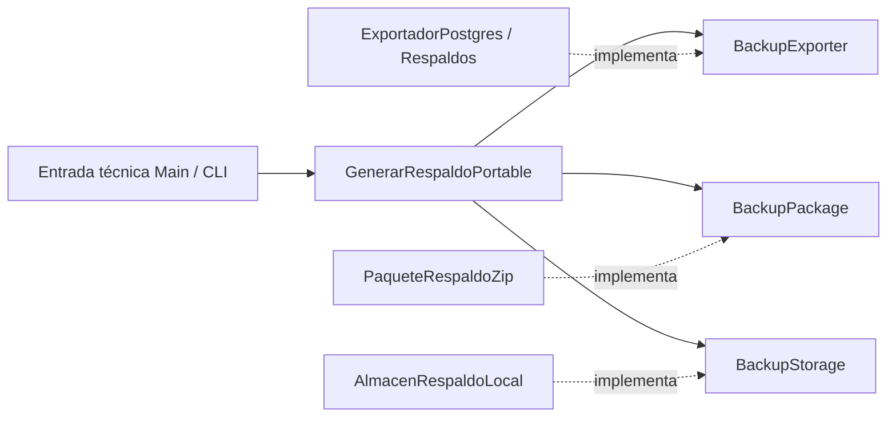

# Respaldos portables — etapa 01 para v1.3.0

Fecha local: 2026-10-14, America/Guayaquil. Rama: `feature/respaldos-restauracion`. Aplicación conservada en 1.2.1 y esquema 10. Alcance: generación manual de archivo único, validación de contenedor y ensayo técnico entre clústeres aislados; sin restauración de producto.

## Estado y alcance

Implementada la infraestructura `.back` v1 sobre el exportador existente. Se conserva el comportamiento legacy `.dump` + `.dump.json`, automático, retención y restore técnico. No se modificaron migraciones 001–010 ni se creó 011. Sin UI, IPC nuevo, onboarding, promoción, journal, Docker, build ni publicación Git.

Al comenzar: rama correcta; cambios previos únicamente de auditoría en `Informe_Auditoria_Respaldos_v1.3.0.md` y continuidad. Ambos se leyeron antes de editar. Se conserva ese informe como documento histórico de diseño, sin reescribir sus hallazgos.

La generación se probó en clúster A nuevo, con fixture pequeño y representativo grande. Después se retiró físicamente el clúster A y sus claves cifradas; B se inicializó con claves nuevas y recibió solamente los `.back`. Las 25 tablas coinciden en conteo y hash y ambos usuarios ingresan con sus claves originales. Esto certifica portabilidad técnica local, no recuperación de producto en otra PC/Windows.

## Arquitectura implementada

| Componente | Responsabilidad |
|---|---|
| `respaldo-portable.ts` | Contratos BackupExporter, BackupPackage, BackupStorage/Workspace, manifest/resultados y caso GenerarRespaldoPortable; no importa fs, Electron ni child_process |
| `respaldo-postgres.ts` | ExportadorRespaldoPostgres adapta Pool + Respaldos al contrato de exportación |
| `respaldos.ts` | `conSnapshot` y `exportarSnapshot` compartidos por crear legacy y exportar portable; conserva locks, snapshot, comprobación major y pg_restore --list |
| `respaldo-integridad.ts` | Metadata stat y SHA-256 por createReadStream, con conteo y comprobación de cambios durante lectura |
| `respaldo-paquete.ts` | Escribe/valida ZIP v1; extracción a nombre fijo para inspección técnica, nunca ejecuta SQL |
| `respaldo-storage.ts` | Workspace propio, copia verificada, flush, sellado por rename, publicación exclusiva, colisiones y limpieza |
| `scripts/mantenimiento.cjs` | Composición técnica Main/Node tras entorno Windows/safeStorage existente; nuevo modo manual portable, sin API Renderer |

Dependencias directas fijadas: yauzl 3.4.0 y yazl 3.3.1; tipos correspondientes solo de desarrollo. Package-lock actualizado sin cambiar versiones existentes de la aplicación. Se consultaron sus [documentación de lectura](https://github.com/thejoshwolfe/yauzl) y [documentación de escritura](https://github.com/thejoshwolfe/yazl); la validación específica del producto se aplica por encima de ambas bibliotecas.

SRP: PostgreSQL exporta; el paquete valida su formato; storage publica; el caso coordina. DIP: el caso depende de esos tres contratos y del permiso de ejecución inyectado. ISP: no hay manager universal. OCP: se puede sustituir paquete/almacenamiento sin reescribir el exportador y se rechaza format_version desconocido. LSP: publicar resuelve solo con archivo final completo; una limpieza secundaria produce advertencia, nunca borra un backup final válido. No se implementó cifrado futuro.



## Contrato exacto `.back` v1

Un ZIP STORE, sin recompresión del dump, con exactamente dos entradas regulares y sin permisos ejecutables: `manifest.json` y `database.dump`. Este último es custom PostgreSQL `pg_dump -Fc`; pg_restore recibe el dump interior, nunca el ZIP. No es cifrado ni autenticación del origen.

Manifest estricto: solo los doce campos siguientes; no se aceptan propiedades adicionales. Ejemplo ilustrativo, no respaldo utilizable:

```json
{
  "product_id": "com.gruporuiz.ruizcacao-manager",
  "format_version": 1,
  "backup_id": "b324ebad-8b3d-4de8-8a3e-eeb937b87c19",
  "created_at_utc": "2026-10-14T18:30:00.000Z",
  "app_version": "1.2.1",
  "schema_version": 10,
  "postgres_server_major": 18,
  "pg_dump_major": 18,
  "backup_type": "manual",
  "database_dump_filename": "database.dump",
  "database_dump_size": 83664,
  "database_dump_sha256": "7e8dc01fa202035d568578d7f569f1329b6c95238b92b8d0492b4bba06bcdcb7"
}
```

Se validan UUID v4, fecha UTC canónica, versión de app, enteros positivos, major exportador/servidor iguales, nombre interno constante, tamaño y SHA-256. La versión del esquema es metadata informativa; esta etapa no decide compatibilidad comercial ni migra. Límite predeterminado: dump de 64 GiB; manifest de 16 KiB y overhead del contenedor acotado. El constructor permite un límite menor para pruebas.

El lector rechaza entradas adicionales, duplicadas, rutas internas absolutas o con traversal/backslash, symlinks, directorios, ejecutables, ZIP cifrado, métodos de compresión ajenos a v1 y discrepancias entre encabezado local/directorio central. Comprueba CRC de ambas entradas, firma PGDMP, tamaño real y SHA-256 del dump mediante streaming. JSON y manifest inválidos fallan; extensión `.back` sola no habilita nada. La extracción usa siempre una ruta proporcionada por infraestructura y apertura exclusiva, no los nombres/rutas del archivo. Ante validación fallida elimina únicamente la extracción creada por esa operación; un destino preexistente permanece intacto.

Ni manifest ni contenedor requieren conexiones cifradas, contraseña técnica, puerto, safeStorage, installation_id externo o rutas de A. El dump mantiene los datos SQL comerciales/técnicos que ya exportaba Respaldos, incluida la tabla de instalación y usuarios; la normalización de identidad destino pertenece a etapa 2, sin tocar datos en etapa 1. No copia roles globales, AppData, data físico, logs, PDFs externos ni archivos cifrados Windows.

## Flujo de generación y publicación

1. La entrada técnica compone el caso después de acceder al entorno local autenticado por Windows/safeStorage. El caso invoca su autorización antes de preparar workspace/exportar. No existe permiso nuevo desde Renderer; la autorización de administrador de la UI futura pertenece a etapa 3.
2. Se prepara un workspace único en almacenamiento local; producción usa userData/backup-workspaces. Se usan permisos restringidos POSIX donde aplican y ACL heredadas del perfil Windows; la política adicional de ACL Windows puede endurecerse después.
3. Respaldos obtiene conexión, advisory lock 7302026, transacción REPEATABLE READ y snapshot exportado. El mismo helper que usa crear ejecuta pg_dump con argv, PGPASSWORD solo en entorno, windowsHide y sin shell; después ejecuta pg_restore --list. El hash usa createReadStream y el tamaño stat. No se carga el dump completo en RAM.
4. Se hace COMMIT y libera lock/conexión antes de empaquetar. No se registra una entrada SQL legacy para el nuevo portable y no se invoca su retención: no se pretende que el catálogo `.dump` gestione archivos `.back`.
5. Se construye el ZIP privado con streams, se cierra y se valida leyendo sus dos entradas.
6. Se copia a un subdirectorio provisional único dentro del destino final, se compara hash/tamaño de la copia y del paquete original, se sincroniza el descriptor y se sella con rename dentro de ese filesystem.
7. Se publica un enlace duro exclusivo al archivo completo. Solo entonces se devuelve éxito. Colisiones producen `_1`, `_2`, etc.; prueba concurrente preserva la copia original. Limpieza retira enlaces provisionales y workspace propios, jamás el final.

**Decisión de publicación respecto al diseño inicial:** `fs.rename` de Node puede sustituir el destino. Para cumplir la prohibición de sobrescribir incluso con concurrencia se usa rename para sellar el temporal y `link` como publicación atómica sin reemplazo. No se afirma que el último paso sea un rename con no-replace que Node no ofrece. Requiere filesystem con hardlinks (probado en NTFS). FAT/exFAT y algunos destinos remotos no están certificados: si no admiten link se falla sin publicar, sin fallback a copia parcial. Un adaptador futuro puede ofrecer una operación nativa de movimiento exclusivo para ampliar compatibilidad.

Si falla antes de publicar no aparece `.back` final parcial. Si falla limpieza después, el caso conserva el archivo válido y devuelve advertencia sanitizada. Si se corta el proceso pueden quedar temporales propios; no se implementó recolector automático ni garantías de journal en esta etapa. El flush reduce exposición a pérdida de buffers pero no certifica durabilidad absoluta ante hardware/pérdida de energía.

## Uso técnico y compatibilidad legacy

Desde `electron-app`, el nuevo comando es:

```powershell
npm run db:backup:portable -- --dest "D:\Respaldos RuizCacao"
```

Nombre: `RuizCacao_YYYY-MM-DD_HH-mm.back`, hora **UTC**, con sufijo en colisiones. No se ejecutó este comando contra el perfil comercial durante la tarea. El CLI conserva el comportamiento de entorno/ciclo del motor de la herramienta previa y no debe detener un servidor que otra instancia pudiera estar usando. La ejecución sin --dest falla antes de abrir el entorno.

`db:backup`, `Respaldos.crear`, validarRestauracion y `db:restore` legacy permanecen. Automáticos, deduplicación, 14 copias y pre_migracion/pre_restauracion siguen usando `.dump` + `.dump.json`; su integridad ahora también es streaming. No se convierte un dump sin JSON a formato portable. No se conectó el restore legacy al Renderer ni se amplió para aceptar ZIP. Los scripts técnicos siguen fuera del instalador: no se presenta el CLI como UI distribuida. El empaquetado excluye además `.back` y Git los ignora para evitar incluir datos por accidente.

OneDrive, Google Drive y Dropbox se tratan como rutas de filesystem, sin SDK ni sincronización gestionada. Se probó una ruta local con esos nombres, espacios y Unicode, no sus clientes reales ni un servidor cloud. El éxito significa archivo local publicado, no carga a la nube completada.

## Pruebas y evidencia

Evidencia en [evidencias-respaldos-etapa01](evidencias-respaldos-etapa01/). Se conserva la corrida inicial y las validaciones finales posteriores; no se sobreescriben evidencias de tareas anteriores.

`tests/respaldo-portable.cjs`: 22 comprobaciones finales, incluida autorización denegada, dos entradas exactas, hash/tamaño, rutas con espacios/Unicode, cinco publicaciones concurrentes sin overwrite, fallo antes de publicación, fallo de publicación, limpieza secundaria fallida, CRC de metadata alterada aún JSON válida, streaming de 64 MiB bloqueando fs.promises.readFile, truncado, extensión falsa, manifest inválido, extra/executable/duplicado, traversal/absolutas, symlink/permisos ejecutables, límite y destino de extracción preexistente conservado. El primer intento restringido falló con EPERM en rename; fuera del sandbox pasan los casos. No se debilitó ninguna aserción.

`tests/respaldo-portabilidad.cjs`: crea sus propios motores A/B, sin leer AppData/conexión comercial. Reutiliza fixture QA para pequeño y generador sintético de integración para grande, exclusivamente en la base recién creada; no ejecuta db:seed:performance. Verifica que generación no cambie ninguna de las 25 tablas de A. Conserva solo `.back`, detiene/elimina clúster A y sus claves, crea B con cifrado y credenciales independientes, extrae/lista y restaura a bases vacías usando rol comercial sin SUPERUSER/CREATEDB y no-owner/no-privileges. Compara todas las filas mediante conteo y MD5 canónico ordenado de JSONB. El SHA-256 protege el dump; MD5 aquí es una huella de igualdad de fixture, no mecanismo de seguridad.

### Conteos comparados A = B en la primera corrida

| Tabla | Pequeño | Grande |
|---|---:|---:|
| usuarios | 2 | 2 |
| clientes | 2 | 1002 |
| proveedores | 2 | 502 |
| empleados | 2 | 2 |
| compras | 2 | 10002 |
| ventas | 2 | 15002 |
| cuentas | 4 | 25004 |
| movimientos_cuenta | 5 | 16671 |
| movimientos_stock | 5 | 25422 |
| gastos | 4 | 13004 |
| jornadas | 1 | 1 |
| migraciones | 10 | 10 |

Las otras trece tablas también coinciden, incluidas configuración, existencias, productos, auditoría y notificaciones. Conteos y hashes completos de las 25 tablas en [portabilidad-inicial.json](evidencias-respaldos-etapa01/portabilidad-inicial.json).

Dump pequeño: 83 664 bytes, SHA-256 `7e8dc01fa202035d568578d7f569f1329b6c95238b92b8d0492b4bba06bcdcb7`. Grande: 3 064 942 bytes, SHA-256 `9ade4db39408db019fcfa5e78214425230d4555161d3ea82aeaebbafc674bbc3`. Son tamaños comprimidos del custom; no equivalen al tamaño físico de las bases. El fixture grande es representativo por cantidad/relaciones, no una certificación de cargas de 64 GiB.

Se comparan hashes antes de ingresar en B: iniciar/login escriben sesiones/auditoría por diseño. Después se prueba principal y operador con contraseña original. No se cambia su contraseña ni se exige datos de A. El código de pruebas comprueba argv sin password y sanitización del error con el secreto técnico real; las regresiones v3 existentes amplían la cobertura de logs/secretos. No se generaron logs de credenciales.

### Validación final

| Comando | Estado |
|---|---|
| npm run typecheck | 0, última versión con CRC y storage verificado |
| npm run lint -- --no-cache | 0, corrida final: 727 warnings de formato, 0 errores; sin diagnósticos en archivos nuevos/modificados de esta implementación |
| npm run db:test | 0, suite PostgreSQL completa; clúster ruizcacao-tests-L0qiXG |
| node tests/respaldo-portable.cjs | 0; 22 casos finales |
| node tests/respaldo-portabilidad.cjs | 0, repetición final pequeño/grande, 25 tablas y login original en ambos |
| git diff --check | 0; incluye comprobación adicional de archivos nuevos de código/documentación |

La suite general se inició antes de añadir CRC explícito y verificación de copia de storage. Después pasaron los 22 casos afectados y se repitió portabilidad con los adaptadores finales, tras terminar los motores de la suite. No se repitieron las regresiones no afectadas. Motores PostgreSQL ejecutados secuencialmente entre pruebas; lint/typecheck y pruebas de contenedor sin motor pudieron correr en paralelo.

Corrida final en [portabilidad-final.json](evidencias-respaldos-etapa01/portabilidad-final.json): mismo conjunto y conteos de 25 tablas, todas las huellas A=B. Dump pequeño 83 642 bytes, SHA-256 `b6c3e9f254cd3f99446cfee1a04aa20d46cadc4b68f818f88e920944ac3c9782`; grande 3 065 231 bytes, SHA-256 `1774d2021c7824d516ee22ccaddeab406fd0706552c0f1f78a27074cb214aa66`. Las huellas entre corridas cambian por UUID/fechas sintéticos nuevos; la comparación exigida es A contra B dentro de cada corrida.

`db-test.txt`, `contenedor-final.txt`, `portabilidad-final.txt`, `typecheck.txt`, `lint-final.txt` y `validacion-final.json` registran cierre. La prueba histórica pg_ctl generó una nueva evidencia, reubicada en esta carpeta como `pgctl-regresion.json`, sin cambiar archivos históricos. Se restauró .eslintcache exclusivamente al contenido inicial tras lint --no-cache. Verificación CIM fuera del sandbox: cero procesos PostgreSQL asociados al clúster principal de la suite y al ensayo final; primer intento restringido de CIM no fue válido y no se usa como evidencia. Los finally de los ensayos anteriores también completaron el cierre de sus motores.

## Archivos de esta etapa

- Nuevos: cinco `src/main/database/respaldo-*.ts`; `tests/respaldo-portable.cjs`, `tests/respaldo-portabilidad.cjs`; este informe y evidencia nueva.
- Modificados: `src/main/database/respaldos.ts`, `scripts/mantenimiento.cjs`, `tests/run.cjs`, `package.json`, `package-lock.json`, `.gitignore`, `electron-builder.yml`, continuidad.
- Preservados: informe de auditoría previo sin cambios, código Renderer/IPC, BaseLocal y PostgresLocal, SQL001–010, fuentes/reglas comerciales y evidencia histórica.

## Riesgos residuales y etapa 2

No hay cifrado ni firma: quien posea el archivo puede leer datos y hashes de usuarios. La validación del contenedor y PGDMP no hace seguro ejecutar SQL arbitrario; cualquier restore de producto requiere aislamiento, permisos mínimos y validación de identidad/esquema/objetos. Se conservan límites previos de herramienta (timeout cinco minutos y salida ocho MiB para listado); cargas mayores deben medirse. Windows limpio/segundo SID/instalador y clientes de sincronización reales pendientes. Destinos sin hardlinks requieren otro adaptador. Permisos Windows heredados y limpieza tras corte merecen pruebas específicas posteriores.

Siguiente paso exacto: etapa 2, extraer MigrationRunner sin efectos de sesión, diseñar staging aislado, validación comercial, identidad de instalación nueva y protocolo de promoción con journal/rollback, antes de ofrecer cualquier botón Restaurar. No reutilizar el restore destructivo CLI como flujo de producto.

## CONTINUAR DESDE AQUI

1. Etapa 1 completada; leer este informe y evidencia final. No hay pruebas pendientes de esta etapa.
2. Revisar limitación de hardlinks del storage: certificación NTFS local; otros filesystems necesitan otro adaptador antes de prometer compatibilidad.
3. Siguiente tarea: etapa 2, MigrationRunner, staging, validación comercial y promoción con journal/rollback; requiere alcance de implementación nuevo.
4. Conservar formato legacy, SQL001–010 y datos comerciales; no conectar restore CLI al Renderer.
5. Mantener prueba Windows limpio/otro SID/instalador y recuperación de producto A→PC B como aceptación futura, no declararlas certificadas por este ensayo local.
6. Ante nuevos cambios repetir solo pruebas afectadas, mantener motores secuenciales y no seed comercial/build/publicación fuera de alcance.

Última prueba con motor: node tests/respaldo-portabilidad.cjs, código 0. Última verificación documental: git diff --check y comprobación no-index de fuentes/documentos nuevos, código 0. No quedan pruebas en ejecución ni resultados obligatorios pendientes. Código funcional comercial intacto; etapa 2 sin implementar.
