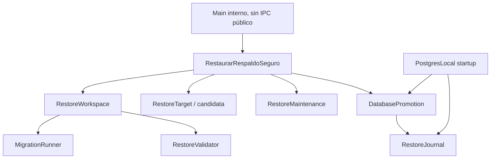

# Etapa 02 — carga segura, política manual y rendimiento

Fecha: 2026-10-15 (America/Guayaquil). Rama feature/respaldos-restauracion. App 1.2.1, esquema10, SQL001–010 intactos; sin011. Implementación backend terminada. Los códigos finales y la evidencia se registran al cierre de este documento.

## Alcance y política definitiva

Leídos auditoría, informe Etapa01 y continuidad antes de modificar. Git inicial limpio, rama correcta y diff-check0. Se conserva Etapa01; no se repite su implementación. No se abrió conexión a la base comercial ni al perfil de desarrollo original. Todo SQL de pruebas apunta a motores temporales creados expresamente por sus arneses.

**Respaldos de usuario exclusivamente manuales.** Se retiran todos los disparos de respaldarCierre: finalizar/reabrir jornada, logout, cierre de aplicación y recuperación de contraseña. No se cambian las reglas de jornada, autorización, saldos ni flujos comerciales. No hay scheduler, polling, watchers, backups periódicos ni retención del nuevo .back. Esta decisión sustituye el plan antiguo de automatización de etapas posteriores; los documentos anteriores se conservan como historia.

Se conservan pre_migracion y pre_restauracion como seguridad técnica, no como respaldos automáticos de usuario. Se conservan clase/formato legacy y su retención para compatibilidad de archivos anteriores, sin disparo automático desde la app. Los tests de v3 se adaptan a la política nueva y siguen verificando las reglas de jornada y retención legacy.

No UI, cambios en Acceso, botones, modal ni IPC público del módulo. El punto de composición es una función interna de Main, con rechazo explícito de modo postgres.enc externo. No se implementa control administrativo de servidores externos ni se elevan privilegios del rol comercial.

## Arquitectura y responsabilidades

| Componente | Responsabilidad |
|---|---|
| migration-runner.ts | SQL histórico reutilizado, historial completo/ordenado y transacciones, sin sesiones/login/AutoRecover/jornadas/limpieza de avisos |
| restore-caso.ts | Coordinación dependiente de contratos RestoreWorkspace, RestoreTarget, DatabasePromotion, RestoreJournal y RestoreMaintenance |
| restore-workspace.ts | Copia privada del .back, contenedor/extracción streaming, referencia confiable, clúster staging y exportación normalizada |
| restore-validacion.ts | Inventario permitido, firma de estructura, controles SQL acotados y normalización técnica |
| restore-destino.ts | Candidata en motor privado destino, estimación de espacio, importación limitada y pre_restauracion |
| restore-journal.ts | Estado persistente pequeño y estricto, sin secretos ni datos comerciales; escritura provisional, flush y rename |
| restore-promocion.ts | Identidad de clúster y OID, exclusión administrativa, renombres, confirmación y recuperación conservadora |
| operacion-respaldo.ts | Máximo un backup y un restore, exclusión de promoción frente a backup y cancelación/cierre sin timers residentes |
| proceso-postgres.ts | spawn sin shell, stdout acotado, stderr drenado, timeout activo y cancelación esperando close |
| archivo-stream.ts y adaptadores Etapa01 | Copia/hash/empaquetado/extracción abortables, con cierre de descriptores |
| conexion.ts / PostgresLocal | Integración Main de mantenimiento, cierre ordenado, composición lazy y recuperación de journal antes de crear nombre fijo |

SRP separa cada mecanismo real. ISP evita un RestoreManager universal. DIP mantiene fs, PostgreSQL, Electron y child_process fuera del coordinador. OCP: las migraciones y validadores pueden evolucionar sin cambiar el orden de coordinación. LSP: cancelar significa terminar recursos antes de devolver control; promover termina confirmando o intentando retorno seguro, y un resultado ambiguo bloquea acceso.

## Migraciones, staging y validación

MigrationRunner recibe una conexión y reutiliza literalmente los SQL existentes y la transición de administrador legado a usuarios. Para restore verifica versiones 1..N completas, sin huecos ni duplicados, rechaza futuro >10, destino desconocido y descenso. Aplica DDL/versiones en la misma transacción; error o cancelación antes del COMMIT revierte. Schema10 se acepta sin migración. El arranque habitual conserva sus consultas previas mediante la llamada interna equivalente, evitando añadir verificaciones SQL del módulo cuando está inactivo; la comprobación completa se usa en restore.

El archivo seleccionado se copia por streaming a un directorio único propio. Se valida nuevamente ZIP v1, SHA-256, CRC, tamaño y entradas exactas; se extrae siempre a una ruta fija privada. Se verifica pg_restore --list y se cotejan versión real de origen/herramienta del TOC con manifest. En esta versión se acepta el mismo major PostgreSQL distribuido; no se certifican cruces de major.

Se crea un clúster privado separado, con credenciales aleatorias nuevas. En él se construye una base de referencia con las migraciones confiables hasta la versión indicada por el manifest. El inventario TOC del respaldo debe ser subconjunto de esa referencia, excluyendo objetos desconocidos, otros esquemas, extensiones o funciones añadidas. El dump se ejecuta solamente con rol comercial NOSUPERUSER/NOCREATEDB/NOCREATEROLE y no-owner/no-privileges. Bootstrap se usa para CREATE DATABASE/administración, nunca para ejecutar contenido del dump.

Tras restore se compara el historial real con el manifest y una firma de metadata de estructura contra la referencia: relaciones, columnas/tipos/defaults/identidades, restricciones/FK validadas, índices, secuencias/parámetros, vistas, función y triggers. No basta product_id, nombre de esquema ni listado. Se migran staging y referencia a10 y se repite comparación. Se exige el conjunto de25 tablas, acceso principal coherente y hashes scrypt válidos; se consultan vistas financieras, existencias y secuencias frente a máximos. No se cargan filas comerciales en Node ni se reconstruye Snapshot. Los hashes de filas completos se usan exclusivamente en el arnés de pruebas.

La referencia y staging permanecen aislados del destino durante ejecución de SQL no confiable. La firma debe coincidir antes de exportar de staging un dump normalizado que se usará para la candidata. Esto no pretende aislar vulnerabilidades del propio motor PostgreSQL o del sistema operativo.

## Identidad destino y preservación

Se conservan IDs, usuarios/password_hash/roles, autoría, fechas, relaciones, compras/ventas/cuentas/abonos, existencias/costos, movimientos/conversiones, gastos, jornadas, configuración, auditoría, notificaciones e historial. No se reconstruye historia con reglas actuales.

En staging se retiran solicitudes firmadas de recuperación anteriores, se renueva installation_id y se reinicia control_recuperacion. Se cierran sesiones antiguas abiertas con motivo técnico restauracion. No se finalizan ni alteran jornadas históricas. Eliminar solicitudes antes de cambiar UUID evita romper su FK. La auditoría histórica permanece. El negocio no requiere credenciales PostgreSQL, puerto, AppData, data físico ni safeStorage del origen.

La candidata recibe el dump ya validado y normalizado, se importa con rol limitado y se vuelve a validar en el clúster destino. La base activa permanece sin sustitución durante toda esta preparación. Los pools de validación se cierran antes de intentar renombres.

## Espacio, mantenimiento y promoción

Se estima temprano espacio con tamaño del .back y un margen mínimo. Después se usa pg_database_size de staging y activa para reservar margen de candidata, copia extraída, pre_restauracion y seguridad. La reserva es un rename de la original, no una duplicación de sus archivos. La estimación inicial es heurística por compresión; ENOSPC durante preparación aborta conservando activa. Nunca se borra la original para conseguir espacio.

Fuera de mantenimiento: copia, validación, staging, migraciones, normalización y candidata. Dentro: impedir nuevas operaciones Main, drenar operaciones existentes mediante locks, generar/verificar pre_restauracion, confirmar intención de carga, cerrar pool, journal/renombres, validación final, reconexión y confirmación persistente. Se mide ese intervalo real.

La desconexión para restauración cierra únicamente la sesión técnica propia con motivo mantenimiento; evita que una reconexión de rollback active AutoRecover sobre una jornada comercial válida. No usa BaseLocal.cerrar porque este sí cierra jornadas. El resto de cierres normales conserva sus reglas.

Promoción: conexión administrativa contra postgres; verificar system_identifier y OID de cada base; bloquear conexiones nuevas a original/candidata; rechazar conexiones pendientes en lugar de terminarlas por fuerza; activa ruizcacao_manager → rcm_r_UUID; candidata rcm_c_UUID → ruizcacao_manager. No son renombres atómicos. La reserva original se conserva, sin limpieza inmediata. La candidata promovida se valida con conexiones limitadas, se reconecta la aplicación manteniendo la puerta de mantenimiento cerrada, se confirma journal y solo entonces se habilitan nuevas escrituras. Confirmar antes de liberar la puerta elimina una ventana en que un reinicio pudiera revertir escrituras nuevas.

## Journal, startup y rollback

Registro local fuera de la base restaurada: operation_id, phase, intent, cluster_identity, nombres internos, OID original/candidata, hash del .back y fechas. No contiene passwords, conexiones completas ni datos comerciales. Los nombres se derivan de UUID generado, nunca del nombre del archivo. Se valida esquema estricto del JSON y se persiste intención antes de cada mutación crítica y resultado después.

Fases: preparada, mantenimiento, seguridad_creada, original_renombrada, candidata_promovida, validada, confirmada; revertida registra retorno seguro. El arranque de PostgresLocal lee el registro antes del CREATE DATABASE habitual. Sin journal no añade consultas SQL del módulo. Registro corrupto, clúster incorrecto u OID/nombres ambiguos bloquean y conservan bases. Nunca crea una ruizcacao_manager vacía si hay una promoción pendiente que debe resolverse.

| Punto de fallo/corte | Resultado diseñado |
|---|---|
| Preparación/staging/migración/candidata | Original conservada; limpiar solo workspace/candidata propios |
| Antes del primer rename | Original identificada se mantiene/habilita; journal revertida |
| Entre renombres | Reserva con OID original vuelve al nombre fijo |
| Candidata promovida sin confirmar | Desconectar y devolver candidata a su alias, restaurar reserva original |
| Validada pero no confirmada | Mismo rollback conservador; UI aún no recibió acceso a escritura |
| Confirmada | Conservar candidata promovida; no volver automáticamente a reserva vieja |
| Ambiguo | Bloquear acceso y conservar todos los datos para soporte |

La recuperación es idempotente por identidad real, no solo por phase. Si el corte sucede después de ejecutar SQL pero antes de persistir resultado, la intención previa y el inventario permiten resolverlo. La copia pre_restauracion se conserva como respaldo adicional, no sustituye a la original reservada. Garantías de flush/rename no equivalen a certificación contra todos los fallos de hardware/filesystem.

## Cancelación y rendimiento inactivo

Contexto con AbortSignal y fases reales, sin porcentajes inventados. Backup: exportación, hash, empaquetado, validación y copia son cancelables. El proceso hijo directo recibe terminación y se espera close; streams/descriptores se cierran antes de limpiar. Enlace final de publicación gana la carrera si ya se completó; nunca se elimina el final válido para fingir cancelación.

Restore: cancelable antes de promoción. Una vez crítica, cancelar/cerrar no interrumpe los renombres; debe terminar o recuperar hasta estado seguro. El cierre normal de Main solicita cancelación de operaciones cancelables y espera liberación; durante fase crítica espera finalización. SQL de migraciones se cancela cooperativamente al terminar la consulta/transacción, dentro del timeout del pool, y no se confirma si la señal ya está abortada.

Un backup y un restore como máximo; se impide iniciar backup durante promoción e iniciar promoción mientras un backup sigue activo. No scheduler, watcher, polling ni timers de backup en reposo. Solo existe timeout mientras una herramienta está activa. El muestreador de rendimiento es un script de test opt-in, excluido del arranque/distribución habitual.

## Pruebas y evidencia de este corte

En docs/evidencias-respaldos-etapa02 se conservan intentos y resultados. Primer intento: error SQL42725 por concatenación de text con tipo char en metadata de trigger; corregido con cast explícito. Ocurrió en staging antes de promoción. Segundo intento: drenaje rechazó backends internos/transitorios; se limita a client backend y espera acotada durante la operación. No se relajaron comprobaciones de preservación. Un perfil posterior excedió el cierre de20s de la fixture histórica: checkpoint de14284 buffers/5623 archivos necesitó más tiempo. Se añadió CHECKPOINT solo a fixtures fuera de mediciones; no se modificaron timeouts ni lifecycle pg_ctl del producto. El perfil definitivo completó sin errores.

Tests nuevos: restore-seguro.cjs (fixtures pequeño/grande, permisos/credenciales distintas, historial1–9, negativos, normalización/login,16 fallos de fase y cancelación) y restore-startup.cjs (cortes entre intención y resultado, antes/entre/después de renombres, confirmación, clúster incorrecto y journal corrupto). Ambos integrados en db:test. Se mantienen las regresiones portables de etapa1.

El perfil opt-in puede ejecutarse en Electron Main sin ventanas y con userData temporal. Registra duración total/por fase, CPU Main, RSS inicial/pico/después, mantenimiento e hijos. El muestreador Windows registra Working Set/CPU PostgreSQL y herramientas identificadas como descendientes o rutas de estos clústeres; no consulta bases ajenas. Renderer N/A porque no existe ventana del módulo. Los picos son muestreados, CPU de procesos breves puede no capturarse y los deltas PostgreSQL son cotas muestreadas, no una medida exacta de todos los procesos transitorios.

### Resultados funcionales y rendimiento

Typecheck definitivo0; lint0,727 advertencias/0 errores. Contratos de rechazo de modo/roles elevados/journal estricto0, incluyendo consulta real de solo lectura a pg_roles del clúster temporal certificado. Este último guard aditivo se comprobó por separado porque se añadió después de cargar el módulo en la suite/perfil; no cambia el algoritmo medido.

La matriz funcional inyecta16 fallos: preparación, importación/migración/normalización staging, importación/validación candidata, antes de mantenimiento, antes/después de pre_restauracion, antes de promoción, pool cerrado, antes de renombrar original, original renombrada, candidata promovida, validación final y validada. Compara datos, usuarios, jornadas y notificaciones antes/después. También cancela restore antes de la fase crítica y rechaza confirmación; conserva original y login. Startup prueba seis estados de intención/corte, incluida confirmación, y bloquea OID ambiguo, identidad de clúster incorrecta y JSON corrupto, sin crear una base vacía.

Perfil definitivo en Electron Main44.3.0/Node24.20.0, sin ventanas ni Renderer. Fixture grande:1000 clientes,500 proveedores,10000 compras,15000 ventas y3000 gastos manuales (más registros mínimos de QA). Dump portable grande de aproximadamente3MB; no representa una base de64GiB.

| Operación | Total s | CPU Main ms | RSS Main antes/pico/después MiB | PG WS pico MiB | CPU PG muestreada ms | CPU herramientas observada ms |
|---|---:|---:|---|---:|---:|---:|
| Inactivo |1,507|47|132,63/133,50/133,50|N/D|N/D|N/D|
| Backup pequeño |0,716|141|142,86/144,47/144,50|229,34|15,63|78,13|
| Backup grande |1,771|843|335,26/335,51/117,59|334,23|0*|312,50|
| Cancelar export |0,135|64|117,59/117,73/117,73|N/D|N/D|N/D|
| Cancelar hash |1,081|78|117,73/117,76/117,93|340,43|218,75|359,38|
| Cancelar paquete |1,217|109|117,93/117,93/116,87|321,26|31,25|218,75|
| Restore pequeño |23,452|2655|110,02/115,47/114,37|448,05|1187,50|62,50|
| Restore grande |29,303|2844|117,76/122,64/116,86|538,82|4171,88|578,13|
| Restore histórico4 |27,054|2797|115,96/119,89/117,02|506,23|1375|468,75|
| Reposo posterior |1,503|16|116,07/116,11/116,11|178,98|0*|N/D|

Mantenimiento pequeño1312,82ms y grande1407,30ms. La creación del aislamiento ocupa13,02/12,68s antes de mantenimiento; importación staging0,65/2,66s, importación candidata0,64/2,60s. Backup grande: export1,002s, hash0,023s, paquete0,110s, verificación0,153s y guardado0,368s. El JSON conserva todos los intervalos de eventos: la última etiqueta antes_promocion incluye promoción y limpieza final; no debe interpretarse como tiempo exclusivo de renombres. El mantenimiento se mide por separado hasta confirmación.

*Cero observado no prueba cero consumo. RSS muestreado cada20ms; Windows cada250ms más coste CIM. WS suma páginas compartidas; CPU PG es cota inferior y herramientas breves pueden escapar al muestreo. La fixture grande se arma en el mismo Main y eleva el RSS inicial; la caída durante backup refleja GC, no una optimización atribuible al módulo. No hay A/B de arranque completo/UI. Evidencia cruda: perfil-validado/restore-seguro.json y restore-recursos.jsonl. Todos los perfiles terminaron con cero hijos. Sin lectura completa de binarios; la regresión de64MiB complementa la evidencia de streaming.

## Archivos y riesgos residuales

Nuevos: migration-runner.ts, archivo-stream.ts, operacion-respaldo.ts, proceso-postgres.ts y seis restore-*.ts; tests restore-seguro/startup/contratos y script medir-restore-recursos.ps1. Modificados: BaseLocal, conexion, PostgresLocal (solo hooks de administración/recovery, no lifecycle pg_ctl), exportador/adaptadores de Etapa01, tests v3/portable/run, documentación y evidencia. SQL001–010, Renderer, preload, Snapshot, paginaciones/virtualización, reportes y reglas financieras quedan fuera del cambio. El inventario exacto de archivos se guarda en validacion-final.json.

Pendientes de aceptación posteriores: UI/IPC con permiso de administrador y lenguaje acordado, onboarding, instalador/Windows limpio/otro SID, ensayo de pérdida completa en otra PC, compatibilidad de majors distintos, hardlinks en destinos no NTFS y prueba física de corte eléctrico. Staging consume arranque privado y espacio extra; se mide, no se oculta esa latencia. No build ni commit/push/merge/tag/Docker.

## CONTINUAR DESDE AQUI

1. Etapa02 backend completada. Leer este informe, validacion-final.json, restore-suite.json y restore-startup.json; no repetir ensayos ya válidos.
2. Siguiente paso exacto: etapa03 de UI/IPC y UX de respaldos manuales, permisos administrativos y confirmación informada, usando el caso interno existente. Requiere su alcance autorizado antes de implementarla.
3. Mantener rechazo de postgres.enc externo, identidad del destino y bloqueo conservador ante journal ambiguo; no conectar el restore CLI legacy a la UI.
4. Conservar reserva y seguridad técnica; no añadir retención de .back ni automatización de usuario.
5. Reservar Windows limpio/otro SID/otra PC/instalador, corte eléctrico físico y destinos sin hardlinks para aceptación posterior. No confundir los ensayos locales con esa certificación.
6. Mantener SQL001–010 y reglas comerciales intactos; sin011 ni cambio de versión en este corte.

### Cierre verificado

npm run db:test terminó con código0: suite aislada ruizcacao-tests-7ozeCT, restore32 comprobaciones/16 fallos, startup6 cortes más rechazos, contenedor portable22 casos, portabilidad A→B25 tablas y login en ambos tamaños, pg_ctl y todas las regresiones comerciales existentes. Ambos motores privados y el padre finalizaron su finally. Contratos adicionales0, perfil Electron0, typecheck0 y lint0 (727 advertencias). git diff --check0; comprobación de whitespace en fuentes/documentos nuevos sin diagnósticos (el código1 normal de no-index por archivo nuevo no es un fallo). Archivos protegidos sin diff. .eslintcache devuelto al estado de entrada.

Comprobación final de procesos Windows, solo lectura:2026-10-15T16:46:49-05:00, cero PostgreSQL/herramientas de estos arneses y cero muestreadores. Sin pruebas activas. Evidencia de la suite copiada sin configuraciones ni credenciales; pgctl-regresion.json corresponde solo al archivo generado en esta corrida. Los intentos fallidos se conservan como historia; no queda prueba obligatoria fallida tras corrección.

Último comando con motores: npm run db:test, código0. Últimos controles: consulta de procesos0 y diff-check0, documentados en validacion-final.json. No acceso al origen comercial; no build, Docker, commit, push, merge ni tag.
